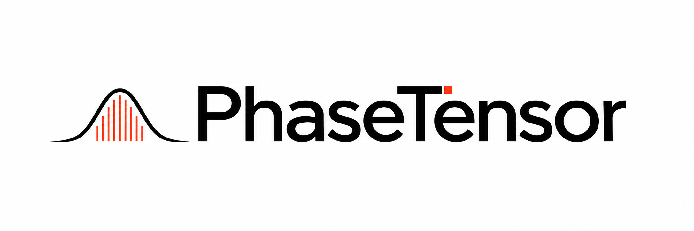

  

<strong>Scientific software for computational research.</strong>

PhaseTensor develops open-source Python libraries for quantum computing, quantitative finance and computational science. Our focus is on practical research problems, mathematical and statistical reliability, and reproducible experiments.

## Open-source libraries

### Quantum Computing

#### ShotWeave

[ShotWeave](https://github.com/Phasetensor/ShotWeave) optimizes quantum measurement allocation under fixed resource budgets. It supports covariance-aware measurement design, integer and cost-constrained allocation, Bayesian and robust strategies, readout-aware allocation, and sequential confidence sequences. It includes Qiskit integration and reproducible 10,000-shot simulation benchmarks.

[Release v0.2.0](https://github.com/Phasetensor/ShotWeave/releases/tag/v0.2.0) · [PyPI](https://pypi.org/project/shotweave/0.2.0/) · [Scientific methods](https://github.com/Phasetensor/ShotWeave/blob/v0.2.0/docs/advanced.md)

#### BornLens

[BornLens](https://github.com/Phasetensor/BornLens) provides finite-shot statistical inference and regression testing for quantum observables. Its advanced methods include simultaneous comparisons, multiple-testing corrections, sequential inference, Bayesian and paired analysis, drift diagnostics and experimental design. Its tolerance verdicts apply to the measured observables, not to unrestricted quantum-state equivalence.

[Release v0.3.1](https://github.com/Phasetensor/BornLens/releases/tag/v0.3.1) · [PyPI](https://pypi.org/project/bornlens/0.3.1/) · [Scientific acceptance](https://github.com/Phasetensor/BornLens/blob/v0.3.1/docs/acceptance-report.md)

#### CalibMap

[CalibMap](https://github.com/Phasetensor/CalibMap) provides offline quantum calibration analytics, historical calibration reconstruction, qubit and gate stability diagnostics, readout uncertainty propagation, drift and change-point detection, topology analysis and forecasting. It integrates with ShotWeave and BornLens; provider compatibility is tested using an offline IBM Runtime snapshot.

[Release v0.1.0](https://github.com/Phasetensor/CalibMap/releases/tag/v0.1.0) · [PyPI](https://pypi.org/project/calibmap/0.1.0/) · [Scientific methods](https://github.com/Phasetensor/CalibMap/blob/v0.1.0/docs/advanced.md)

### Quantitative Finance

#### VintageCheck

[VintageCheck](https://github.com/Phasetensor/VintageCheck) audits point-in-time data integrity and quantitative research pipelines. It supports historical information sets, survivorship and corporate-action checks, feature lineage, temporal cross-validation, revision statistics and streaming Parquet audits. Its benchmark evaluates one million synthetic decisions with a fixed three-release reference index. Missing evidence is reported separately from confirmed violations.

[Release v0.4.0](https://github.com/Phasetensor/VintageCheck/releases/tag/v0.4.0) · [PyPI](https://pypi.org/project/vintagecheck/0.4.0/) · [Scientific methods](https://github.com/Phasetensor/VintageCheck/blob/v0.4.0/docs/advanced.md)

#### CurveMetric

[CurveMetric](https://github.com/Phasetensor/CurveMetric) helps fixed-income researchers assess how calibration quotes and interpolation choices affect discount factors, forward rates and portfolio valuations. It includes calibration stability diagnostics, uncertainty propagation, historical curve PCA, multi-curve diagnostics, portfolio risk and stress analysis. Its evidence includes analytical tests, QuantLib comparisons and reproducible benchmarks.

[Release v1.5.0](https://github.com/Phasetensor/CurveMetric/releases/tag/v1.5.0) · [PyPI](https://pypi.org/project/curvemetric/1.5.0/) · [Scientific methods](https://github.com/Phasetensor/CurveMetric/blob/v1.5.0/docs/advanced.md)

#### SurfaceCheck

[SurfaceCheck](https://github.com/Phasetensor/SurfaceCheck) validates European option quotes and implied volatility surfaces under explicit deterministic discounting and carry assumptions. It includes implied volatility inversion, butterfly and calendar arbitrage diagnostics, SVI and restricted SSVI calibration, risk-neutral density and local volatility diagnostics, constrained finite-grid repair and historical surface analysis. It integrates with VintageCheck and CurveMetric.

[Release v0.1.0](https://github.com/Phasetensor/SurfaceCheck/releases/tag/v0.1.0) · [PyPI](https://pypi.org/project/surfacecheck/0.1.0/) · [Scientific methods](https://github.com/Phasetensor/SurfaceCheck/blob/v0.1.0/docs/methodology.md)

## Research roadmap

Six libraries are publicly released across two complementary research suites. The current phase focuses on maintenance, reproducibility, external feedback and adoption. Future candidates span quantum circuit mapping, numerical PDE methods, computational chemistry and tensor contraction.

[Research roadmap](https://github.com/Phasetensor/.github/blob/main/standards/ROADMAP.md)

## Research principles

- Start with a concrete research problem and an explicit baseline.
- Use reproducible experiments and transparent evaluation criteria.
- Document assumptions, uncertainty, and limitations.
- Publish methods and benchmark results alongside validated software.

## Availability

All six released libraries are available on PyPI under the Apache 2.0 license. See individual repositories for installation instructions, supported environments, evidence and limitations.
